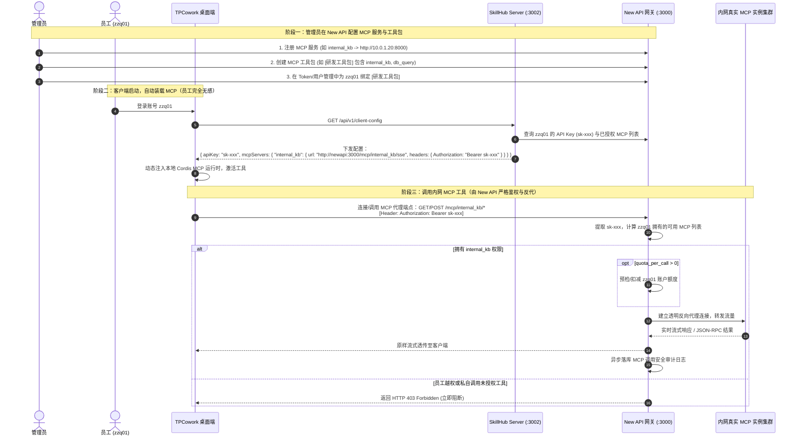

# 需求规格说明书：New API 内网 MCP 注册、透明反代与角色权限管控

## Problem Statement (问题陈述)

随着企业大模型应用的深入，员工个人电脑上的桌面协同客户端（**TPCowork**）需要频繁调用企业内网自建或采购的共享工具服务（**MCP，Model Context Protocol**），如企业私有知识库检索、内网数据库只读查询、内部系统工单与报表生成等。

然而，在现有的企业网络与网关拓扑中，面临如下核心痛点：
1. **网络与安全边界风险**：内网 MCP 服务通常包含企业敏感数据与内部 API 鉴权凭证。如果直接让员工个人电脑直连内网真实 MCP 实例，不仅需要对全员开放网络端口，且后端服务账密无法对员工隐藏，极易引发越权与数据泄露。
2. **缺乏集中化工具管控与审计**：管理员无法统一控制哪些部门、哪些员工有权使用哪些内网工具，缺乏统一的调用审计日志（谁在什么时间调用了哪个 MCP 工具）。
3. **客户端配置分发繁琐且易被篡改**：若由员工在本地客户端手工填写 MCP 服务的 URL 与 Token，维护成本极高，且员工可在本地私自添加未经批准的外部工具。
4. **与既有大模型调度体系割裂**：组织已在 New API 中统一维护了一人一卡（Token 与用户名一一绑定，如 `zzq01`），但工具能力缺乏与现有身份与权限体系的打通。

## Solution (解决方案)

基于访谈确定的 **BAB + 方案 2（通用透明反代 + 字段级独立数据表 + 支持按次配额扣减 + MCP 角色工具包 RBAC 解耦）**，在 New API 构建企业级 **MCP 集中管控与反向代理网关**：

1. **New API 充当统一 MCP 反向代理网关（Decision B - 通用透明管道）**：
   - 暴露统一外部端点：`/mcp/:name/*any`（支持 GET、POST、SSE 长连接以及全双工流式传输）。
   - 客户端携带原生的专属密钥（`Authorization: Bearer sk-xxxx`）发起请求。
   - 网关不篡改、不深度侵入 MCP 内部 JSON-RPC 报文协议，实现无损、零时延的高性能透明反向代理，无缝自适应当前与未来所有 MCP 协议格式。
2. **轻量级 RBAC 工具包角色模型（方案 2）**：
   - 将“大模型渠道/倍率分组（Group）”与“工具权限（MCP Role）”彻底正交解耦。
   - 引入 **MCP 工具包/角色（`mcp_roles`）** 概念：管理员将若干 MCP 编组为工具包（如【全员通用包】、【研发工具包】、【财务工具包】），并支持将常用工具包标记为“全员默认”。
   - 在员工的 API 令牌（Token）上关联分配对应的工具包（`mcp_roles`）。当某个工具包新增或删除工具时，全员自动无感联动生效。
3. **多维安全鉴权与阻断机制**：
   - 请求流经网关前置中间件时，自动解析 `Bearer sk-xxxx`，合并计算出该用户当前拥有的全部可用 MCP 标识集合。
   - 若目标 `:name` 不在集合内，立即阻断并返回 `HTTP 403 Forbidden`。
4. **按次配额管控与调用安全审计（Decision B - 支持配额扣减）**：
   - 在 MCP 基础信息中可指定单次调用消耗配额 `quota_per_call`（默认 `0`，内网常规共享服务不扣费，高算力任务可配置固定扣额）。
   - 每次调用成功后，记录独立的 `LogTypeMCP` 审计明细（包含用户 ID、Token Name、MCP 标识、耗时、状态与扣额）。
5. **客户端（TPCowork）与配置中台（SkillHub Server）自动联动闭环**：
   - 配合扩展 SkillHub Server 的 `/api/v1/client-config` 接口，员工在 TPCowork 登录后，直接一次性获取直连 New API 的专属密钥以及该员工被授权的所有 `mcpServers` 连接清单；TPCowork 本地自动静默挂载，普通员工界面锁定不可篡改，达成 100% 集中受控。

---

## Architecture & Sequence Flow (全链路时序图)



---

## User Stories (用户故事列表)

1. **作为安全管理员**，我希望把内网敏感的 MCP 服务隐藏在 New API 网关之后，只对外暴露网关代理地址，防止员工直连内网或获取内部服务的真实凭证。
2. **作为系统管理员**，我希望能够创建“工具包/角色”（如全员通用包、研发工具包、财务工具包），把相关工具打包管理，以便于在新员工入职或转岗时批量赋予工具权限。
3. **作为系统管理员**，我希望当某个工具包追加新工具时，所有属于该角色的员工客户端下次启动时自动同步并激活新工具，无需逐一修改员工账号配置。
4. **作为系统管理员**，我希望能够为特定高算力、高成本的 MCP 工具设置单次调用扣减的配额（`quota_per_call`），防止个别用户无节制调用导致内网资源过载。
5. **作为终端员工 `zzq01`**，我希望打开 TPCowork 登录账号后，我所属岗位需要的内网知识库、内部数据库等工具全部自动配置就绪，无需手动拷贝复杂的 URL 和秘钥。
6. **作为终端员工 `zzq01`**，我希望调用内网 MCP 工具时享受与直连无异的极速长连接与流式响应体验，网关反代不增加任何额外卡顿或报文序列化开销。
7. **作为审计人员**，我希望在管理后台能够查询所有 MCP 调用的时间、操作人、调用的具体工具名称、耗时与扣减配额，以备合规审计与异常排查。
8. **作为安全合规系统**，当未授权员工或恶意脚本尝试通过私增配置调用受限工具（如未被授予财务工具包的员工调用 `finance_export`）时，网关必须强行阻断并返回 `403 Forbidden`。

---

## Implementation Decisions (实施决策与设计规范)

### 1. 数据模型层 (Schema - GORM 三库兼容)

在 `model/` 包中新增 MCP 相关的核心数据模型，必须严格遵循项目规范（完全兼容 SQLite、MySQL >= 5.7.8、PostgreSQL >= 9.6）：

#### (1) `model.MCPServer`（MCP 服务定义表：`mcp_servers`）
```go
type MCPServer struct {
    Id           int            `json:"id" gorm:"primaryKey;autoIncrement"`
    Name         string         `json:"name" gorm:"type:varchar(64);uniqueIndex;not null"` // 英文唯一标识，如 internal_kb
    DisplayName  string         `json:"display_name" gorm:"type:varchar(128);not null"`    // 显示名称
    Description  string         `json:"description" gorm:"type:text"`                      // 描述
    BaseURL      string         `json:"base_url" gorm:"type:varchar(512);not null"`        // 内网真实目标基础地址
    Status       int            `json:"status" gorm:"type:int;default:1;index"`            // 1: 启用, 2: 停用
    QuotaPerCall int            `json:"quota_per_call" gorm:"type:int;default:0"`          // 单次调用扣减额度，0 表示免费
    CreatedAt    int64          `json:"created_at" gorm:"autoCreateTime"`
    UpdatedAt    int64          `json:"updated_at" gorm:"autoUpdateTime"`
    DeletedAt    gorm.DeletedAt `json:"-" gorm:"index"`
}
```

#### (2) `model.MCPRole`（MCP 工具包/角色定义表：`mcp_roles`）
```go
type MCPRole struct {
    Id          int            `json:"id" gorm:"primaryKey;autoIncrement"`
    Name        string         `json:"name" gorm:"type:varchar(64);uniqueIndex;not null"` // 角色代码，如 developer
    DisplayName string         `json:"display_name" gorm:"type:varchar(128);not null"`    // 角色名称，如 研发工具包
    Description string         `json:"description" gorm:"type:text"`                      // 描述
    MCPServers  string         `json:"mcp_servers" gorm:"type:text"`                      // 包含的 MCP Name 列表，JSON 数组格式如 ["internal_kb", "db_query"]
    IsDefault   bool           `json:"is_default" gorm:"default:false;index"`             // 是否全员默认拥有（免勾选自动赋予）
    CreatedAt   int64          `json:"created_at" gorm:"autoCreateTime"`
    UpdatedAt   int64          `json:"updated_at" gorm:"autoUpdateTime"`
    DeletedAt   gorm.DeletedAt `json:"-" gorm:"index"`
}
```

#### (3) `model.Token` 既有结构体扩展
在 `model/token.go` 中的 `Token` 结构体新增：
```go
// MCPRoles 该令牌关联的 MCP 工具包代码列表，JSON 数组格式存储，如 ["developer"]
MCPRoles string `json:"mcp_roles" gorm:"type:text"`
```
并提供配套辅助方法：
- `func (token *Token) GetMCPRoles() ([]string, error)`
- `func (token *Token) SetMCPRoles(roles []string) error`

---

### 2. 网关反向代理层 (Reverse Proxy Engine)

- **核心包路径**：`service/mcp/proxy.go` 与 `controller/mcp.go`。
- **路由注册**：
  在 `router/api-router.go` 中注册通用透明反代通道：
  ```go
  mcpRoute := router.Group("/mcp")
  mcpRoute.Use(middleware.TokenAuth(), middleware.MCPPermissionCheck())
  {
      mcpRoute.Any("/:name/*any", controller.RelayMCPRequest)
  }
  ```
- **中间件鉴权流（`middleware.MCPPermissionCheck`）**：
  1. 通过 `middleware.TokenAuth()` 解析并验证客户端传入的 `sk-xxxx`；
  2. 获取请求路径中的 `:name` 参数（即目标 MCP 标识）；
  3. 读取该 Token 绑定的 `mcp_roles`，联合所有 `is_default=true` 的全局工具包，计算该 Token 实际拥有的所有有效 `mcp_servers` 集合；
  4. 检查目标 `:name` 是否在集合内，且目标服务状态为启用：
     - 若不在：直接中断并返回 `c.JSON(http.StatusForbidden, gin.H{"error": "Forbidden: You do not have permission to access this MCP server"})`；
     - 若在：将解析出的目标 `MCPServer` 元数据注入 `c.Set("mcp_server", server)`，放行进入下级处理。
- **透明反向代理引擎（`controller.RelayMCPRequest`）**：
  - 使用 Go 原生 `httputil.ReverseProxy` 实现高性能透明代理；
  - 动态重写目标 URL：
    - 客户端请求路径：`/mcp/:name/sse?query=1` -> 代理至：`{base_url}/sse?query=1`；
    - 客户端请求路径：`/mcp/:name/messages` -> 代理至：`{base_url}/messages`；
  - 完美支持长连接：设置 `FlushInterval: -1`（或 100ms），确保打字机 SSE 流式事件无缓冲即时推送到客户端；
  - 自动剥离/替换 Host 请求头，防止内网后端虚拟主机识别失败。

---

### 3. 审计日志与配额结算机制 (Audit & Quota Settlement)

- **日志类型扩展**：在 `model/log.go` 中定义新型日志类型常量 `LogTypeMCP = 4`。
- **额度扣减**：
  - 若 `MCPServer.QuotaPerCall > 0`：
    - 在请求代理成功建立后，通过 `model.DecreaseUserQuota(userId, quota)` 原子扣减对应额度；
    - 扣减前进行余额充足性校验，若不足直接返回 `429 Too Many Requests (Quota Exceeded)`。
- **日志持久化**：
  - 记录每次代理的耗时、客户端 IP、Token Name、调用的 MCP Name，写入主 `Log` 表，供管理员在后台「日志」页面筛选查看。

---

### 4. 协同管理接口与 SkillHub Server 联动 (Config Distribution)

- **New API 提供客户端可用 MCP 查询接口**：
  `GET /api/mcp/my-servers`（使用 Token 认证）
  - 响应示例：
    ```json
    {
      "success": true,
      "data": [
        {
          "name": "internal_kb",
          "display_name": "企业知识库",
          "proxy_url": "/mcp/internal_kb/sse",
          "description": "企业内部制度、文档与技术规范检索"
        }
      ]
    }
    ```
- **SkillHub Server (`d:\Pyprojects\skillhubserver`) 联动适配**：
  - 在 `backend/app/main.py` 的 `/api/v1/client-config` 接口中，根据当前登录用户的活跃 Token，动态组装标准 MCP 客户端配置块：
    ```json
    {
      "baseURL": "http://192.168.1.7:3000/v1",
      "apiKey": "sk-sLIoid...HQ4R",
      "model": "glm-5.3",
      "quotaStatus": "active",
      "mcpServers": {
        "internal_kb": {
          "type": "sse",
          "url": "http://192.168.1.7:3000/mcp/internal_kb/sse",
          "headers": {
            "Authorization": "Bearer sk-sLIoid...HQ4R"
          }
        }
      }
    }
    ```
  - TPCowork 桌面端启动后自动将 `mcpServers` 挂载到本地 Cordis 运行时，实现开箱即用。

---

### 5. 控制台前端交互层 (Web Console)

严格遵循前端规范与现有的 shadcn-ui + TanStack Router/Table 架构：
1. **侧边栏导航**：在管理菜单中新增「MCP 管理」，包含两个子 Tab 或列表页面：
   - **MCP 服务列表**：查看、新增、编辑、停用内网 MCP，配置后端真实地址与单次配额；
   - **工具包/角色管理**：创建工具包，多选勾选包含的 MCP 服务，勾选“设为全员默认”。
2. **令牌编辑弹窗（Key Dialog）**：
   - 在创建与编辑 API Key 弹窗中，新增「MCP 工具包」多选下拉组件，允许为该 Key 分配特定角色包（如【研发工具包】）。
3. **i18n 国际化完整覆盖**：
   - 所有新增 UI 文本严格添加至 `web/src/i18n/locales/` 下全部 7 个语言文件（en, zh, zh-TW, fr, ja, ru, vi）。

---

## Testing Decisions (测试决策与验证标准)

1. **GORM 三数据库兼容性保证**：
   - 验证 `AutoMigrate` 自动创建 `mcp_servers` 与 `mcp_roles` 表在 SQLite、PostgreSQL 下无语法错误。
2. **权限阻断端到端测试**：
   - Case 1 (正常代理)：拥有有效角色权限的 Key 访问 `/mcp/:name/*`，断言返回 HTTP 200 并收到内网服务输出。
   - Case 2 (未授权拦截)：未被赋予该工具包的 Key 访问相同端点，断言返回 HTTP 403。
   - Case 3 (无效/过期 Key)：断言返回 HTTP 401。
   - Case 4 (配额扣减)：对配置了 `quota_per_call > 0` 的 MCP，断言调用后用户的 `used_quota` 增加且余额正确扣减。
3. **流式长连接保持测试**：
   - 验证 SSE 事件流能够实时打字机推送到客户端，中间反代层无缓冲截断。
